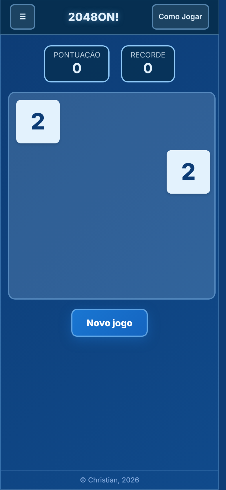
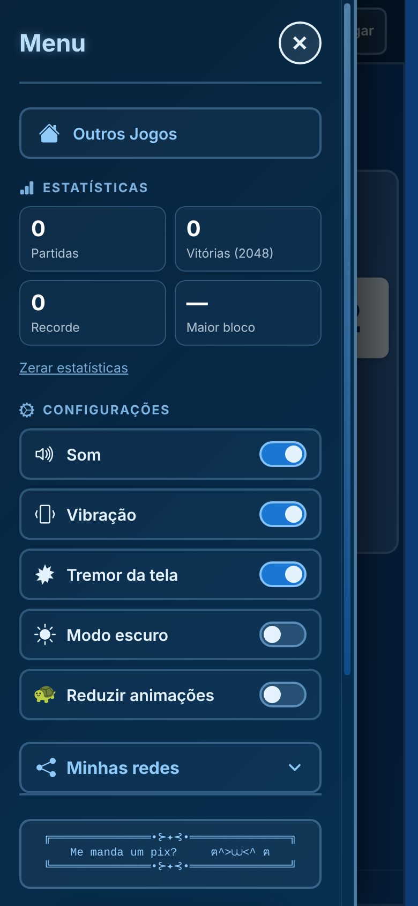
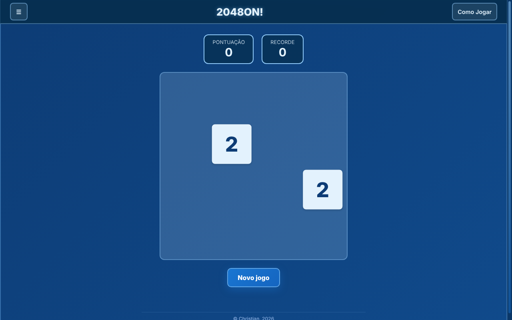

# 2048ON!

O clássico 2048 com o visual da família ON!: fundo azul, peças em tons de azul e o dourado reservado para a peça 2048. Junte blocos iguais até chegar ao **2048**.

**Jogue:** https://2048on.netlify.app/ · **Mais jogos:** https://speccygames.netlify.app/

<p align="center">
  
  &nbsp;&nbsp;
  
</p>
<p align="center">
  
</p>

## Como jogar

- **Mover:** setas do teclado (também `W A S D` e `H J K L`) ou deslize o dedo na tela.
- **Combinar:** dois blocos com o mesmo número se somam quando se encontram.
- **Vencer:** forme o bloco **2048**. Depois disso você pode continuar jogando para bater recordes.
- **Fim de jogo:** o tabuleiro enche e não há mais movimentos possíveis.
- **Novo jogo:** botão **Novo jogo** ou tecla `R`. Com uma partida em andamento o jogo pergunta antes, e desistir conta como partida sem vitória nas estatísticas.

O botão **Como Jogar** do topo traz a explicação completa, com exemplos.

## Recursos

- Partida e recorde salvos no navegador: feche e continue depois
- Animações de peça nova, fusão e pontos subindo (`+N`), com movimento por `transform` (fluido em celulares fracos)
- Controle por toque em toda a área do jogo
- Menu lateral: atalho **Outros Jogos** (leva à hub), **estatísticas** (partidas, vitórias, maior bloco, recorde), **configurações** (som, vibração, tremor da tela, modo escuro, reduzir animações), instalar app e redes
- **Ao perder:** o celular vibra e a tela treme (opções "Vibração" e "Tremor da tela" no menu)
- **PWA:** instala e funciona offline
- Sem dependências, sem build

## Estrutura

```
.
├── index.html
├── on.css / on.js        base compartilhada ON! (igual em todos os projetos)
├── style.css             estilos só do 2048ON! (tabuleiro por variáveis CSS)
├── script.js             lógica do jogo e interface
├── manifest.json         dados do PWA
├── service-worker.js     cache para uso offline
├── LICENSE               MIT (Gabriele Cirulli)
├── screenshots/
└── assets/               ícones e QR Pix
```

## Dados salvos no navegador

| Chave (`localStorage`) | Conteúdo |
|---|---|
| `gameState` | partida em andamento |
| `bestScore` | recorde de pontos |
| `2048on.stats` | partidas, vitórias e maior bloco |
| `2048on.cfg` | som, vibração, tremor da tela, modo escuro, reduzir animações |

## Rodando localmente

O service worker precisa de `http://`, então use um servidor local em vez de abrir o arquivo direto:

```bash
python3 -m http.server 8000
# abra http://localhost:8000
```

## Publicando (Netlify)

O jogo é estático: não há build. No Netlify, arraste a pasta do projeto (ou ligue o repositório) com **publish directory** na raiz e **build command** vazio. Todos os caminhos são relativos.

- Endereço: **https://2048on.netlify.app/**
- O menu lateral tem um atalho "Outros Jogos" que abre a hub (`https://speccygames.netlify.app/`). **Adicionar um jogo novo não exige publicar este jogo de novo**: a lista fica só na hub.

## Instalando como app

- **Chrome / Edge (computador e Android):** botão **Instalar app** no menu ☰ (aparece quando o navegador permite) ou o ícone na barra de endereço.
- **Safari (iPhone/iPad):** compartilhar → *Adicionar à Tela de Início*.

## Atualizando o jogo

O service worker entrega os arquivos do cache primeiro. A cada publicação com arquivo alterado, aumente a versão em `CACHE_NAME` no `service-worker.js` (`2048on-v4` → próxima), senão quem já abriu o jogo continua vendo a versão antiga. Se criar ou remover arquivos, atualize também a lista `FILES_TO_CACHE` (ou rode `gerar-sw.py`, descrito em `PADRAO.md`).

## Base compartilhada ON!

`on.css` e `on.js` são **idênticos em todos os projetos** (header, menu lateral, modais, botões, rodapé, configurações, estatísticas, som e vibração). O que é específico do jogo fica em `style.css` e `script.js`. Detalhes e regras em `PADRAO.md`.

## Créditos e licença

A lógica do jogo parte do [2048](https://github.com/gabrielecirulli/2048), de Gabriele Cirulli, sob licença **MIT**. O aviso de copyright e a licença estão no `LICENSE` e no topo do `script.js`, e devem ser mantidos. A interface, o visual, o menu e as modificações são do 2048ON!.

## Família ON!

2048ON! usa a mesma base visual do **DiciON!**, assim como o **MinesON!**.

---

Feito por Christian ([@Christian5910](https://github.com/Christian5910)).
